# Distributed Task Queue

An asynchronous, Redis-backed distributed task queue built with Python (FastAPI) demonstrating core distributed systems design patterns: multi-level priority scheduling, delayed execution, worker lease tracking, automated crash recovery, dead-letter queue (DLQ) inspection with atomic replay, and declarative Kubernetes orchestration.

---

## Architecture Overview

```mermaid
flowchart TD
    subgraph Clients["Clients & Producers"]
        HTTPClient["HTTP Client / Producer"]
        Browser["Web Browser"]
    end

    subgraph APISvc["FastAPI Service"]
        API["FastAPI API Endpoints"]
        Dashboard["Monitoring Dashboard (/dashboard)"]
        WSEndpoint["WebSocket Hub (/ws/jobs)"]
    end

    subgraph RedisBroker["Redis Storage & Broker"]
        subgraph Queues["Priority Ready Queues (Lists)"]
            QHigh["dtq:queue:high"]
            QMed["dtq:queue:medium"]
            QLow["dtq:queue:low"]
        end
        DelayedZSet["dtq:delayed (ZSET: score=run_timestamp)"]
        InFlightZSet["dtq:in-flight (ZSET: score=lease_expires_at)"]
        InFlightOwners["dtq:in-flight:owners (Hash: job_id -> worker_id)"]
        DLQList["dtq:dead-letter (List)"]
        JobState["dtq:job:id (JSON Metadata)"]
        PubSub["dtq:events (Pub/Sub & Event List)"]
    end

    subgraph WorkerPool["Worker Pool (Deployments / Loops)"]
        WorkerLoop["Worker Processing Loops"]
        Heartbeat["Lease Heartbeat Loop"]
        Scheduler["Delayed Promotion Loop"]
        Recovery["Crash Recovery Scanner"]
        Executor["Task Executor"]
    end

    HTTPClient -->|"POST /jobs"| API
    HTTPClient -->|"GET /jobs/:id"| API
    HTTPClient -->|"GET /queues/dead-letter"| API
    HTTPClient -->|"POST /jobs/:id/replay"| API
    Browser -->|"HTTP GET"| Dashboard
    Browser -->|"WebSocket Subscribe"| WSEndpoint

    API -->|"Persist job state"| JobState
    API -->|"Push job ID"| QHigh
    API -->|"Push job ID"| QMed
    API -->|"Push job ID"| QLow
    API -->|"Add delayed job"| DelayedZSet
    API -->|"Atomic Replay (WATCH/MULTI)"| DLQList
    API -->|"Read DLQ jobs"| DLQList
    API -->|"Publish events"| PubSub
    PubSub -->|"Broadcast events"| WSEndpoint

    Scheduler -->|"Promote due jobs"| DelayedZSet
    Scheduler -->|"Push to ready"| Queues

    Recovery -->|"Scan expired leases"| InFlightZSet
    Recovery -->|"Requeue abandoned jobs"| Queues

    WorkerLoop -->|"Atomic Dequeue & Lease"| Queues
    WorkerLoop -->|"Register In-Flight"| InFlightZSet
    WorkerLoop -->|"Register Owner"| InFlightOwners

    WorkerLoop -->|"Execute Task"| Executor
    Heartbeat -.->|"Renew lease timestamp"| InFlightZSet

    Executor -->|"Success: Mark succeeded"| JobState
    Executor -->|"Success: Clear in-flight"| InFlightZSet
    Executor -->|"Retry: Schedule with backoff"| DelayedZSet
    Executor -->|"Failure: Push dead-letter"| DLQList
```



---

## Key Features

- **Strict Priority Scheduling:** Strict multi-level queue polling (`high` $\to$ `medium` $\to$ `low`) ensures latency-sensitive background tasks execute before background bulk jobs.
- **Delayed & Scheduled Jobs:** Defers tasks for up to 86,400 seconds (24 hours) using epoch-scored Redis Sorted Sets (`ZSET`).
- **Worker Crash Recovery & Leases:** Replaced destructive queue pops (`RPOP`) with an atomic in-flight lease mechanism (`WATCH`/`MULTI`). Workers maintain heartbeats; if a worker crashes or is evicted, expired leases are detected and re-queued automatically.
- **Dead-Letter Queue (DLQ) & Atomic Replay:** Failed jobs exceeding their retry ceiling are isolated into `dtq:dead-letter`. Dedicated REST endpoints support paginated inspection, detail lookup, and atomic replay back into the appropriate priority queue.
- **Exponential Backoff Retries:** Failed jobs are automatically rescheduled with exponential backoff:
  $$\text{delay} = \text{RETRY\_BACKOFF\_BASE\_SECONDS} \times 2^{(\text{attempts} - 1)}$$
- **Decoupled Workloads & Independent Scaling:** API and worker workloads are decoupled, enabling API web tiers and worker pools to scale horizontally independently.
- **Observability & Dashboards:** Built-in web monitoring dashboard at `/dashboard` powered by Redis Pub/Sub WebSockets, combined with structured JSON logging (`structlog`).
- **Production-Style Health Probes:** The `/health` endpoint checks Redis connectivity via `PING` and returns **HTTP 503 Service Unavailable** when Redis is unreachable, ensuring Kubernetes readiness probes avoid routing traffic to degraded pods.
- **Graceful Termination:** Workers intercept `SIGTERM` and `SIGINT` signals, finishing current in-flight execution loops before terminating.

---

## Technologies Used

Based strictly on project dependencies and codebase implementation:

- **Language:** Python 3.11+
- **API Framework:** [FastAPI](https://fastapi.tiangolo.com/) `0.115.x`, [Uvicorn](https://www.uvicorn.org/) (ASGI server), [Starlette](https://www.starlette.io/) (WebSockets)
- **Data Broker & State Store:** [Redis](https://redis.io/) 7 (`redis-py` 5.x) – Lists, Sorted Sets (`ZSET`), Hashes, Pub/Sub, and Pipelines (`WATCH`/`MULTI`)
- **Data Validation & Settings:** [Pydantic v2](https://docs.pydantic.dev/), [pydantic-settings](https://docs.pydantic.dev/latest/concepts/pydantic_settings/)
- **Structured Logging:** [Structlog](https://www.structlog.org/) (formatted JSON log output)
- **Containerization & Orchestration:** Docker, Docker Compose, Kubernetes (Docker Desktop K8s, Kustomize)
- **Testing & Quality:** [Pytest](https://pytest.org/), [pytest-asyncio](https://github.com/pytest-dev/pytest-asyncio), [fakeredis](https://github.com/cunla/fakeredis-py) (isolated in-memory Redis testing), [HTTPX](https://www.python-httpx.org/), [Ruff](https://astral.sh/ruff) (linter & code formatter)

---

## Repository Structure

```text
distributed-task-queue/
├── app/
│   ├── config.py           # Pydantic environment settings
│   ├── dashboard.py        # Embedded HTML/JS dashboard
│   ├── events.py           # Redis Pub/Sub event broadcaster & subscriber
│   ├── logging_config.py   # Structlog configuration
│   ├── main.py             # FastAPI REST routes, probes & WebSocket endpoints
│   ├── models.py           # Pydantic schemas (Job, JobCreate, QueueStats, etc.)
│   ├── queue.py            # Redis queue operations, leases, recovery & DLQ logic
│   ├── redis_client.py     # Redis client connection factory
│   └── worker.py           # Asynchronous worker loops, executor & heartbeat
├── k8s/
│   ├── api.yaml            # API Deployment (2 replicas) & NodePort Service
│   ├── configmap.yaml      # Shared environment variables ConfigMap
│   ├── kustomization.yaml  # Kustomize manifest bundle
│   ├── redis.yaml          # Redis Deployment (1 replica) & ClusterIP Service
│   └── worker.yaml         # Worker Deployment (2 replicas, independent scaling)
├── tests/
│   ├── conftest.py         # Pytest fixtures and fakeredis client setup
│   ├── test_api.py         # API route & health probe tests
│   ├── test_dead_letter.py # DLQ listing, pagination & atomic replay tests
│   ├── test_priority.py    # Strict priority ordering tests
│   ├── test_queue.py       # Core queue operations & delayed job tests
│   ├── test_recovery.py    # In-flight lease, heartbeat & crash recovery tests
│   ├── test_retries.py     # Exponential backoff retry tests
│   └── test_worker.py      # Worker loop & execution tests
├── Dockerfile              # Multi-stage/lightweight Python 3.11 container image
├── docker-compose.yml      # Local Compose stack (API, Redis, Worker)
├── pyproject.toml          # Project metadata, dependencies & tool configs
└── README.md
```

---

## Local Setup

### Option 1: Docker Compose (Recommended)

Run the full stack (Redis, API, and Worker) with Docker Compose:

```bash
docker compose up --build
```

Services exposed:
- **FastAPI API & Docs:** [http://localhost:8000/docs](http://localhost:8000/docs)
- **Monitoring Dashboard:** [http://localhost:8000/dashboard](http://localhost:8000/dashboard)
- **Redis Server:** `localhost:6379`
- **Worker:** Background worker running 4 concurrent loops.

Stop the stack:
```bash
docker compose down
```

---

### Option 2: Local Virtual Environment

#### 1. Setup Virtual Environment & Dependencies
```bash
python -m venv .venv

# On Linux/macOS:
source .venv/bin/activate

# On Windows (PowerShell):
.\.venv\Scripts\Activate.ps1

pip install -e ".[dev]"
cp .env.example .env
```

#### 2. Start Redis
```bash
docker run --name dtq-redis -p 6379:6379 -d redis:7-alpine
```

#### 3. Run the API Server
```bash
uvicorn app.main:app --host 0.0.0.0 --port 8000 --reload
```

#### 4. Run the Worker (Separate Terminal)
```bash
python -m app.worker
```

---

## Kubernetes Setup (Docker Desktop)

The repository provides declarative Kubernetes manifests under `k8s/` designed for local deployment using **Docker Desktop Kubernetes**. Redis, the API, and background workers run as decoupled workloads so workers and API replicas can scale independently.

### 1. Enable Kubernetes in Docker Desktop
1. Open **Docker Desktop Settings** (gear icon).
2. Navigate to the **Kubernetes** tab.
3. Check **Enable Kubernetes** and click **Apply & restart**.
4. Verify your local cluster in PowerShell:
   ```powershell
   kubectl cluster-info
   kubectl get nodes
   ```

### 2. Build the Local Container Image
Build the container image into Docker Desktop's daemon so Kubernetes can consume it locally without an external registry:
```powershell
docker build -t distributed-task-queue:latest .
```
*(Manifests use `imagePullPolicy: IfNotPresent` to consume this local image directly).*

### 3. Deploy the Stack
Deploy the ConfigMap, Redis, API, and Worker deployments using Kustomize:
```powershell
kubectl apply -k k8s
```

### 4. Verify Rollout Status
```powershell
kubectl rollout status deployment/redis
kubectl rollout status deployment/api
kubectl rollout status deployment/worker
kubectl get pods -o wide
```

### 5. Access the API & Docs
You can access the API either through port-forwarding or via the NodePort service:

```powershell
# Port-forward API service (use 8080 if Docker Compose is using 8000)
kubectl port-forward svc/api 8000:8000
```

- **Interactive Swagger Docs:** [http://localhost:8000/docs](http://localhost:8000/docs)
- **Monitoring Dashboard:** [http://localhost:8000/dashboard](http://localhost:8000/dashboard)
- **Health & Readiness Check:** [http://localhost:8000/health](http://localhost:8000/health) (returns HTTP 503 if Redis fails)
- **NodePort Access:** [http://localhost:30080/health](http://localhost:30080/health)

### 6. Inspect Structured Logs
```powershell
# Stream API logs
kubectl logs -l app=api --tail=50 -f

# Stream worker logs across all replicas
kubectl logs -l app=worker --tail=50 -f

# Stream Redis logs
kubectl logs -l app=redis --tail=50 -f
```

### 7. Scale Workers Independently
Scale the worker pool to handle higher queue volumes without affecting the API:
```powershell
kubectl scale deployment/worker --replicas=4
kubectl rollout status deployment/worker
kubectl get pods -l app=worker
```

### 8. Teardown Kubernetes Resources
```powershell
kubectl delete -k k8s
```

---

## API Reference & Examples

### 1. Submit a Standard Job
**Endpoint:** `POST /jobs`

```bash
curl -X POST http://localhost:8000/jobs \
  -H "Content-Type: application/json" \
  -d '{
    "task_name": "send_welcome_email",
    "payload": {
      "user_id": "usr_1001",
      "email": "user@example.com"
    },
    "priority": "high",
    "delay_seconds": 0,
    "max_retries": 3
  }'
```

**Response (HTTP 201 Created):**
```json
{
  "job_id": "8e37bb96-d62f-410a-8a56-b08be2ffbc4d",
  "status": "queued"
}
```

---

### 2. Submit a Delayed Job
**Endpoint:** `POST /jobs`

```bash
curl -X POST http://localhost:8000/jobs \
  -H "Content-Type: application/json" \
  -d '{
    "task_name": "generate_weekly_report",
    "payload": {
      "report_id": "rpt_9901"
    },
    "priority": "medium",
    "delay_seconds": 60,
    "max_retries": 2
  }'
```

**Response (HTTP 201 Created):**
```json
{
  "job_id": "4bfdc6ee-6ff3-4b08-9dfd-5a9d665b16f3",
  "status": "delayed"
}
```

---

### 3. Retrieve Job Status
**Endpoint:** `GET /jobs/{job_id}`

```bash
curl http://localhost:8000/jobs/8e37bb96-d62f-410a-8a56-b08be2ffbc4d
```

**Response (HTTP 200 OK):**
```json
{
  "job_id": "8e37bb96-d62f-410a-8a56-b08be2ffbc4d",
  "task_name": "send_welcome_email",
  "payload": {
    "user_id": "usr_1001",
    "email": "user@example.com"
  },
  "priority": "high",
  "status": "succeeded",
  "attempts": 1,
  "max_retries": 3,
  "created_at": "2026-10-11T16:00:00Z",
  "updated_at": "2026-10-11T16:00:01Z",
  "started_at": "2026-10-11T16:00:00.500000Z",
  "finished_at": "2026-10-11T16:00:01Z",
  "error_message": null
}
```

---

### 4. Queue Statistics & In-Flight Metrics
**Endpoint:** `GET /queues/stats`

```bash
curl http://localhost:8000/queues/stats
```

**Response (HTTP 200 OK):**
```json
{
  "total_jobs": 15,
  "queued_jobs": 3,
  "delayed_jobs": 1,
  "in_flight_jobs": 2,
  "running_jobs": 2,
  "succeeded_jobs": 8,
  "failed_jobs": 0,
  "dead_letter_jobs": 1,
  "queues": {
    "high": 1,
    "medium": 2,
    "low": 0
  }
}
```

---

### 5. List Dead-Letter Queue (Paginated)
**Endpoint:** `GET /queues/dead-letter?limit=10&offset=0` *(also supports `GET /jobs/dead-letter`)*

```bash
curl "http://localhost:8000/queues/dead-letter?limit=10&offset=0"
```

**Response (HTTP 200 OK):**
```json
[
  {
    "job_id": "fa2163b2-6523-4557-9db6-e9185bcdd70f",
    "task_name": "always_fail",
    "payload": {},
    "priority": "medium",
    "status": "dead",
    "attempts": 4,
    "max_retries": 3,
    "created_at": "2026-10-11T16:05:00Z",
    "updated_at": "2026-10-11T16:05:30Z",
    "started_at": "2026-10-11T16:05:29Z",
    "finished_at": "2026-10-11T16:05:30Z",
    "error_message": "Simulated task failure"
  }
]
```

---

### 6. Inspect Specific Dead-Letter Job
**Endpoint:** `GET /queues/dead-letter/{job_id}` *(also supports `GET /jobs/dead-letter/{job_id}`)*

```bash
curl http://localhost:8000/queues/dead-letter/fa2163b2-6523-4557-9db6-e9185bcdd70f
```

**Response (HTTP 200 OK):**
Returns the full `Job` object above. Returns `HTTP 404 Not Found` if the job does not exist, or `HTTP 400 Bad Request` if the job exists but is not dead-lettered.

---

### 7. Replay Dead-Lettered Job
**Endpoint:** `POST /jobs/{job_id}/replay` *(also supports `POST /queues/dead-letter/{job_id}/replay`)*

Atomically removes the job from `dtq:dead-letter`, resets attempts to `0`, clears previous error messages, sets status to `queued`, and re-inserts the job into its original priority queue using Redis `WATCH`/`MULTI` pipeline transactions.

```bash
curl -X POST http://localhost:8000/jobs/fa2163b2-6523-4557-9db6-e9185bcdd70f/replay
```

**Response (HTTP 200 OK):**
```json
{
  "job_id": "fa2163b2-6523-4557-9db6-e9185bcdd70f",
  "task_name": "always_fail",
  "payload": {},
  "priority": "medium",
  "status": "queued",
  "attempts": 0,
  "max_retries": 3,
  "created_at": "2026-10-11T16:05:00Z",
  "updated_at": "2026-10-11T16:10:00Z",
  "started_at": null,
  "finished_at": null,
  "error_message": null
}
```

*Note: Repeated replay calls for the same job will safely return `HTTP 409 Conflict` ("Job is not dead-lettered"), preventing duplicate replay races.*

---

### 8. Health Check Probe
**Endpoint:** `GET /health`

```bash
curl http://localhost:8000/health
```

**Healthy Response (HTTP 200 OK):**
```json
{
  "status": "ok",
  "redis": "ok"
}
```

**Degraded Response (HTTP 503 Service Unavailable):**
```json
{
  "status": "degraded",
  "redis": "unavailable"
}
```

---

## Reliability Guarantees & Distributed Systems Trade-offs

### 1. Delivery Guarantees: At-Least-Once Delivery
- **Mechanism:** When a worker dequeues a job, it registers the job into `dtq:in-flight` with a lease expiration timestamp (`utc_now() + lease_timeout_seconds`) and stores worker ownership in `dtq:in-flight:owners`.
- **Heartbeat & Abandonment:** Active workers refresh this lease periodically (every 10 seconds by default). If a worker process crashes, is killed by OOM, or network partitions occur, the lease expires.
- **Recovery:** Any active worker's recovery scanner detects expired leases and re-enqueues the job into its priority queue.
- **Duplicate Execution Risk:** Because a worker may crash *after* executing side-effects but *before* clearing the lease, jobs may be executed more than once. **Task handlers executed by this system must be designed to be idempotent.**

### 2. Concurrency Model: Cooperative Async
- Concurrency inside each worker process is driven by Python's `asyncio` event loop.
- **Limitation:** Long-running, blocking CPU-bound computations (such as unthreaded image transformations or synchronous cryptographic hashing) will block the single OS thread, delaying heartbeats and stalling other worker loops. Compute-heavy tasks must be offloaded to process pools or executed with `asyncio.to_thread`.

### 3. Ephemeral Redis Storage in Kubernetes
- **Current Setup:** The included `k8s/redis.yaml` manifest deploys a single-replica standalone Redis container using ephemeral pod storage.
- **Limitation:** If the Redis pod restarts or is rescheduled, in-memory queues and unpersisted job records will be lost.
- **Production Requirement:** A production deployment requires persistent storage via a Kubernetes `PersistentVolumeClaim` (PVC) with Redis Append-Only File (`AOF`) persistence enabled, or a managed cloud Redis service (e.g., AWS ElastiCache, GCP Memorystore) with multi-AZ replication.

### 4. Single Point of Failure (SPOF)
- Redis currently runs as a standalone deployment without Redis Sentinel or Redis Cluster active failover.

### 5. Strict Priority Starvation
- Workers drain `high` priority jobs exhaustively before inspecting `medium` or `low`. Under sustained high-priority traffic, medium and low jobs can experience queue starvation without age-based promotion mechanisms.

---

## Testing & Quality

The repository includes a comprehensive automated test suite of **39 tests** built with `pytest` and `fakeredis`. Tests execute entirely in memory and do not require an active Redis instance.

### Run Tests
```bash
# In virtual environment:
pytest -v
```

### Run Linter & Formatter
```bash
# Check code style and common bugs:
ruff check .
```

### Test Suite Breakdown
| Test Suite | File | Behaviors Verified |
|---|---|---|
| **API Endpoints** | `tests/test_api.py` | Job submission, lookup, validation errors, queue stats, and HTTP 503 health check behavior. |
| **Dead-Letter Queue** | `tests/test_dead_letter.py` | DLQ listing, pagination offsets, job retrieval, atomic replay, repeated replay 409 conflict, and concurrent replay race protection. |
| **Worker Recovery** | `tests/test_recovery.py` | In-flight lease registration, heartbeat lease renewal, simulated worker crash recovery, retry cleanup, and abandoned job re-queueing. |
| **Priority Ordering** | `tests/test_priority.py` | Strict `high` $\to$ `medium` $\to$ `low` dequeuing order. |
| **Queue Operations** | `tests/test_queue.py` | Delayed job score promotion, FIFO queue order, and job metadata serialization. |
| **Retries & Backoff** | `tests/test_retries.py` | Exponential backoff scheduling, retry attempt counting, and transition to dead-letter queue after retry exhaustion. |
| **Worker Processing** | `tests/test_worker.py` | Multi-loop asynchronous concurrency and execution lifecycle. |

---

## Upstream Attribution & Enhancements

This project was built upon the open-source foundational prototype [shubham-2451/Distributed-Job-Queue](https://github.com/shubham-2451/Distributed-Job-Queue) (initial implementation authored by Nour Eddine Mermoune). 

While the original prototype introduced the initial FastAPI structure, basic priority lists, and simulated task execution, it relied on destructive `RPOP` operations without worker crash recovery, lacked DLQ inspection/replay, and returned false-positive health checks.

### Key Enhancements Implemented in this Repository:
1. **At-Least-Once Delivery & Worker Crash Recovery:**
   - Eliminated data loss from destructive `RPOP`.
   - Designed atomic in-flight leases (`dtq:in-flight`) and worker ownership tracking (`dtq:in-flight:owners`).
   - Implemented background lease heartbeats and an automated orphaned job recovery scanner.
2. **Dead-Letter Queue (DLQ) Management & Atomic Replay:**
   - Implemented `GET /queues/dead-letter` with pagination (`offset`, `limit`) and `GET /queues/dead-letter/{job_id}`.
   - Built atomic `POST /jobs/{job_id}/replay` utilizing Redis `WATCH`/`MULTI` transactions to prevent duplicate enqueues under concurrent replay requests.
3. **Local Kubernetes Deployment (`k8s/`):**
   - Built declarative K8s manifests for Redis, API (2 replicas), and Worker (2 replicas) with independent horizontal scaling.
   - Configured CPU/memory requests and limits, ConfigMap injection, and NodePort exposure (`30080`).
4. **Resilient Health & Readiness Probes:**
   - Updated `/health` to actively ping Redis and return **HTTP 503 Service Unavailable** on disconnect, preventing Kubernetes from routing traffic to unready pods.
5. **Graceful Worker Shutdown:**
   - Implemented signal-handling architecture supporting `SIGTERM` and `SIGINT` with cross-platform event loop compatibility.
6. **Expanded Test Suite:**
   - Grew the automated test coverage from 14 basic unit tests to **39 comprehensive async tests** covering failure injection, concurrency races, and recovery semantics, maintained under strict Ruff linting.
